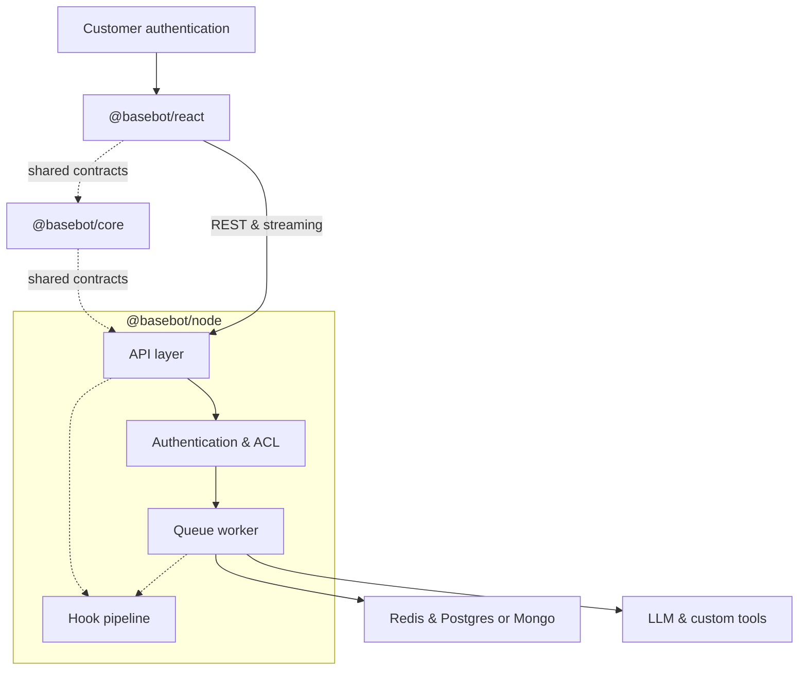

# baseBot

Embeddable AI chat framework: a React widget, Node.js server SDK, and shared API contracts for streaming conversations with per-user thread isolation.

## Architecture



## Packages

| Package | Description |
|---------|-------------|
| `@basebot/core` | Shared types, Zod schemas, error codes, OpenAPI generation |
| `@basebot/node` | Fastify server, Postgres or Mongo durable store, Redis cache, queue worker, LLM adapters |
| `@basebot/react` | `BaseBotChat` widget and HTTP client |

Runnable reference apps live under **`demos/`**:
- **`node-demo`** — telecom support agent (real tools on `@basebot/node`)
- **`react-demo`** — embeddable widget

Use root `pnpm demo` / `pnpm demo:widget`.

## Prerequisites

- Node.js 20+
- [pnpm](https://pnpm.io/) 9+
- Docker (Postgres + Redis for local development; Mongo optional via `DURABLE_STORE=mongo`)

## Quick start

1. **Start dependencies**

   ```bash
   docker compose up -d
   ```

2. **Configure environment** (demo / integrator only — not used by `@basebot/node`)

   ```bash
   cp demos/node-demo/.env.example .env
   ```

   Export variables in your shell (or use your host’s secret injection). Required for the telecom demo include `DATABASE_URL`, `REDIS_URL`, `STREAM_SIGNING_SECRET`, and `OPENAI_API_KEY` (embeddings + default chat). See `demos/node-demo/.env.example` for the full list. Chat provider selection uses `resolveLlmConfigFromEnv()` in the demo bootstrap, not inside the framework.

3. **Install, build, and set up the Postgres demo** (compose → framework migrate → demo migrate → seed)

   ```bash
   pnpm install
   pnpm build
   pnpm demo:setup
   ```

   Or run the same steps manually: `docker compose up -d`, `pnpm migrate`, `pnpm --filter @basebot/example-node-demo run migrate:demo`, `pnpm seed:demo` (seed requires `OPENAI_API_KEY`).

4. **Run demos** (set `OPENAI_API_KEY` and `SERPER_API_KEY` in `.env`)

   ```bash
   pnpm demo          # Node API on http://localhost:3000
   pnpm demo:widget   # React demo (Vite dev server)
   ```

## Scripts

| Command | Purpose |
|---------|---------|
| `pnpm test` | Unit tests across packages |
| `pnpm lint` | ESLint |
| `pnpm typecheck` | TypeScript |
| `pnpm generate:openapi` | Regenerate `docs/openapi.yaml` |
| `pnpm demo` | Telecom agent server (`demos/node-demo`) |
| `pnpm migrate` | baseBot Postgres migrations |
| `pnpm demo:setup` | Compose up + framework/demo migrate + seed (Postgres path) |
| `pnpm seed:demo` | Seed telecom TOML + support manual embeddings |
| `pnpm --filter @basebot/example-node-demo run migrate:demo` | Telecom schema + pgvector (Postgres) |

## API

HTTP contract and schemas live in `@basebot/core`. After changing routes or payloads, run `pnpm generate:openapi` and commit `docs/openapi.yaml`.

## Integration guide

See [docs/integration-guide.md](docs/integration-guide.md) for framework vs telecom demo boundaries and tool wiring.

## Load testing

See `tests/load/k6-stream.js` for a k6 script against the demo API.
