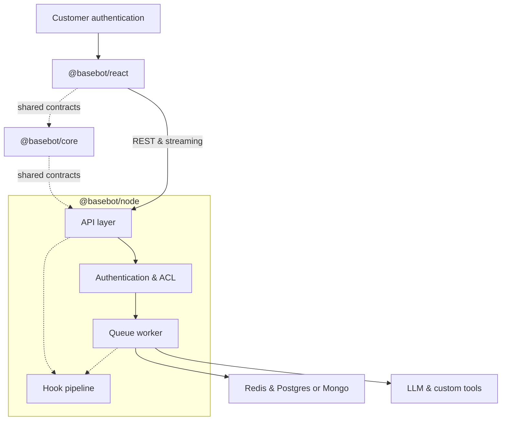
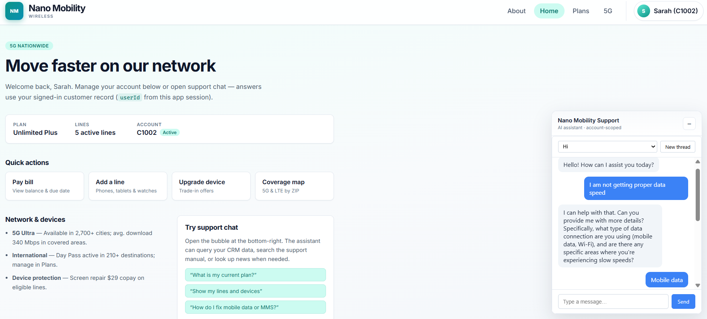

# baseBot

Embeddable AI chat framework: a React widget, Node.js server SDK, and shared API contracts for streaming conversations with per-user thread isolation.

## Architecture



## Packages

| Package | Description |
|---------|-------------|
| `@basebot/core` | Shared types, Zod schemas, error codes, OpenAPI generation |
| `@basebot/node` | Fastify server, Postgres or Mongo durable store, Redis cache, queue worker, LLM adapters |
| `@basebot/react` | `BaseBotChat` widget and HTTP client |

Runnable reference apps live under **`demos/`**:
- **`node-demo`** — telecom support agent (real tools on `@basebot/node`)
- **`react-demo`** — embeddable widget

Use root `pnpm demo` / `pnpm demo:widget`.

## Prerequisites

- Node.js 20+
- [pnpm](https://pnpm.io/) 9+
- Docker (Postgres + Redis for local development; Mongo optional via `DURABLE_STORE=mongo`)

## Quick start

One-command setup after env is configured (Postgres + pgvector path):

```bash
cp demos/node-demo/.env.example .env   # or cp .env.example .env
# Set OPENAI_API_KEY, SERPER_API_KEY (and optional LLM_PROVIDER + provider keys)

pnpm install
pnpm build
pnpm demo:setup    # compose up → migrate → seed (OPENAI_API_KEY required for seed)
pnpm demo          # Node API on http://localhost:3000
pnpm demo:widget   # React widget (Vite)
```

In the widget, send a message (for example *What is my current plan?*) and confirm a **streamed reply** with **tool calls** (CRM / support manual / web search). Sample prompts: [integration guide — E2E verification](docs/integration-guide.md#manual-smoke-check).

### Showcase demo

`pnpm demo:widget` serves **Nano Mobility** (`demos/react-demo`): a sample host page with account-scoped support chat. More prompts: [integration guide](docs/integration-guide.md#manual-smoke-check).



## Scripts

| Command | Purpose |
|---------|---------|
| `pnpm test` | Unit tests across packages |
| `pnpm lint` | ESLint |
| `pnpm typecheck` | TypeScript |
| `pnpm generate:openapi` | Regenerate `docs/openapi.yaml` |
| `pnpm demo` | Telecom agent server (`demos/node-demo`) |
| `pnpm migrate` | baseBot Postgres migrations |
| `pnpm demo:setup` | Compose up + migrate/seed per `DURABLE_STORE` (Postgres default; `--profile mongo` when `mongo`) |
| `pnpm seed:demo` | Seed telecom TOML + support manual embeddings |
| `pnpm --filter @basebot/example-node-demo run migrate:demo` | Telecom schema + pgvector (Postgres) |

## API

HTTP contract and schemas live in `@basebot/core`. After changing routes or payloads, run `pnpm generate:openapi` and commit `docs/openapi.yaml`.

## Integration guide

See [docs/integration-guide.md](docs/integration-guide.md) for framework vs telecom demo boundaries and tool wiring.

## Load testing

See `tests/load/k6-stream.js` for a k6 script against the demo API (includes `ttft_ms` p95 threshold).
