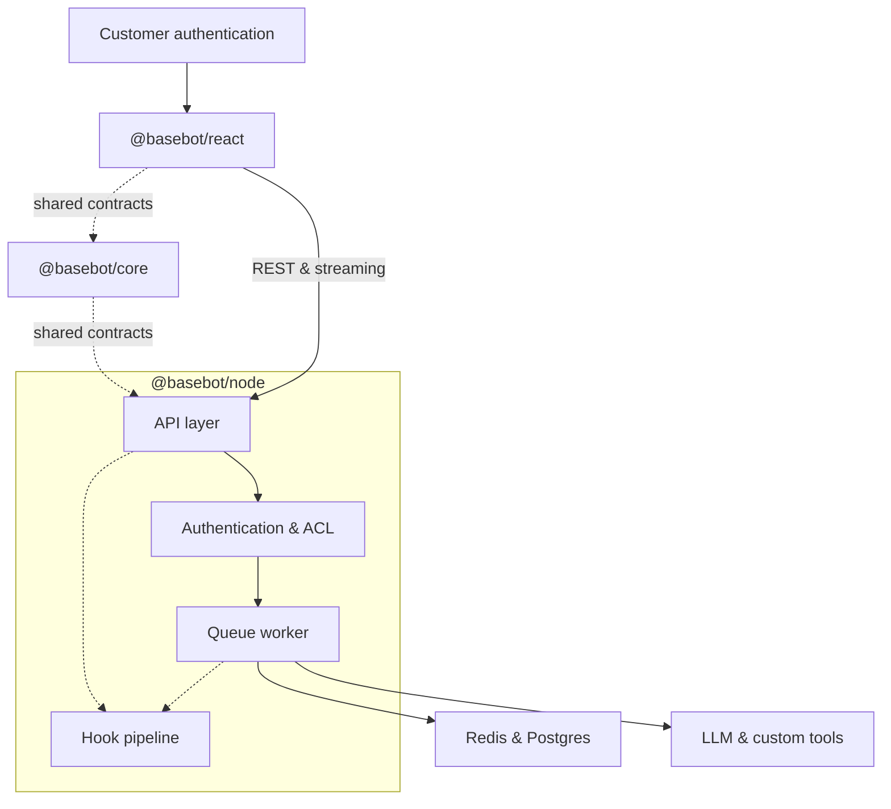

# baseBot

Embeddable AI chat framework: a React widget, Node.js server SDK, and shared API contracts for streaming conversations with per-user thread isolation.

## Architecture



## Packages

| Package | Description |
|---------|-------------|
| `@basebot/core` | Shared types, Zod schemas, error codes, OpenAPI generation |
| `@basebot/node` | Fastify server, Postgres/Redis adapters, queue worker, LLM adapters |
| `@basebot/react` | `BaseBotChat` widget and HTTP client |

Runnable reference apps live under **`demos/`** (`node-demo`, `react-demo`), wired to the root `pnpm demo` scripts.

## Prerequisites

- Node.js 20+
- [pnpm](https://pnpm.io/) 9+
- Docker (Postgres + Redis for local development)

## Quick start

1. **Start dependencies**

   ```bash
   docker compose up -d
   ```

2. **Configure environment**

   ```bash
   cp .env.example .env
   ```

   Defaults match `docker-compose.yml` (Postgres on port **5434**). Set `OPENAI_API_KEY` for real LLM responses; otherwise the demo uses a mock provider.

3. **Install, build, migrate**

   ```bash
   pnpm install
   pnpm build
   pnpm migrate
   ```

4. **Run demos**

   ```bash
   pnpm demo          # Node API on http://localhost:3000
   pnpm demo:widget   # React demo (Vite dev server)
   ```

## Scripts

| Command | Purpose |
|---------|---------|
| `pnpm test` | Unit tests across packages |
| `pnpm lint` | ESLint |
| `pnpm typecheck` | TypeScript |
| `pnpm generate:openapi` | Regenerate `docs/openapi.yaml` |
| `pnpm demo` | Node demo server (`demos/node-demo`) |

## API

HTTP contract and schemas live in `@basebot/core`. After changing routes or payloads, run `pnpm generate:openapi` and commit `docs/openapi.yaml`.

## Load testing

See `tests/load/k6-stream.js` for a k6 script against the demo API.
