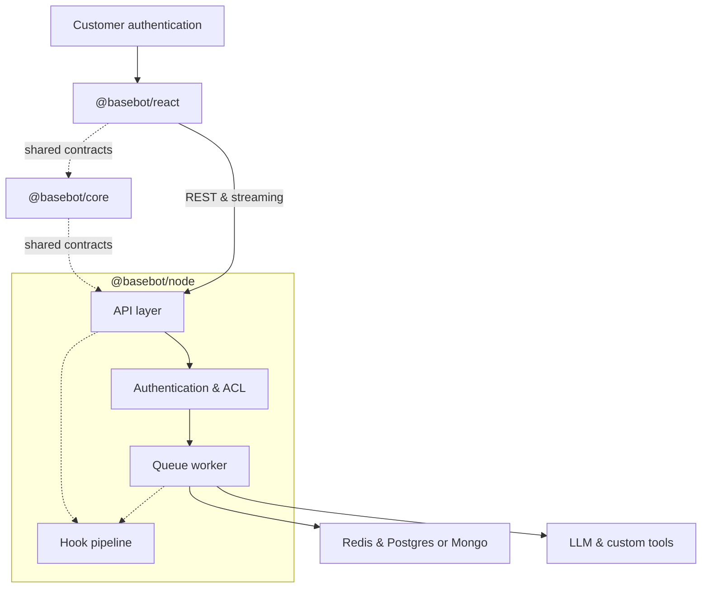

# baseBot

Embeddable AI chat framework: a React widget, Node.js server SDK, and shared API contracts for streaming conversations with per-user thread isolation.

## Architecture



## Packages

| Package | Description |
|---------|-------------|
| `@basebot/core` | Shared types, Zod schemas, error codes, OpenAPI generation |
| `@basebot/node` | Fastify server, Postgres or Mongo durable store, Redis cache, queue worker, LLM adapters |
| `@basebot/react` | `BaseBotChat` widget and HTTP client |

Runnable reference apps live under **`demos/`**:
- **`node-demo`** — telecom support agent (real tools on `@basebot/node`)
- **`react-demo`** — embeddable widget

Use root `pnpm demo` / `pnpm demo:widget`.

## Prerequisites

- Node.js 20+
- [pnpm](https://pnpm.io/) 9+
- Docker (Postgres + Redis for local development; Mongo optional via `DURABLE_STORE=mongo`)

## Quick start

One-command setup after env is configured (Postgres + pgvector path):

```bash
cp demos/node-demo/.env.example .env   # or cp .env.example .env
# Set OPENAI_API_KEY, SERPER_API_KEY (and optional LLM_PROVIDER + provider keys)

pnpm install
pnpm build
pnpm demo:setup    # compose up → migrate → seed (OPENAI_API_KEY required for seed)
pnpm demo          # Node API on http://localhost:3000
pnpm demo:widget   # React widget (Vite)
```

In the widget, send a message (for example *What is my current plan?*) and confirm a **streamed reply** with **tool calls** (CRM / support manual / web search). Sample prompts: [integration guide — E2E verification](docs/integration-guide.md#e2e-tool-verification-manual).

### Environment (demo only)

`@basebot/node` does not read deployment env vars; the telecom demo uses `loadDemoConfig()` and `resolveLlmConfigFromEnv()`. See `demos/node-demo/.env.example` for:

| Variable | Purpose |
|----------|---------|
| `OPENAI_API_KEY` | Embeddings + default chat (`LLM_PROVIDER` unset) |
| `SERPER_API_KEY` | `web_search` tool |
| `LLM_PROVIDER` | Optional: `openai`, `gemini`, `claude`, `deepseek`, or `mock` (no live chat key) |
| `GEMINI_API_KEY`, `ANTHROPIC_API_KEY`, `DEEPSEEK_API_KEY` | Required when matching `LLM_PROVIDER` is set |

### Mongo durable store (optional)

Local **vector** demos should stay on Postgres (pgvector). To exercise the **Mongo thread/message adapter** and telecom CRM on Mongo:

```bash
# In .env: DURABLE_STORE=mongo, MONGODB_URL=mongodb://localhost:27017/basebot
pnpm demo:setup    # docker compose --profile mongo up -d → seed (no Postgres migrations)
pnpm demo
```

`docker compose --profile mongo up -d` starts Postgres, Redis, and Mongo; only Mongo is used when `DURABLE_STORE=mongo`.

## Scripts

| Command | Purpose |
|---------|---------|
| `pnpm test` | Unit tests across packages |
| `pnpm lint` | ESLint |
| `pnpm typecheck` | TypeScript |
| `pnpm generate:openapi` | Regenerate `docs/openapi.yaml` |
| `pnpm demo` | Telecom agent server (`demos/node-demo`) |
| `pnpm migrate` | baseBot Postgres migrations |
| `pnpm demo:setup` | Compose up + migrate/seed per `DURABLE_STORE` (Postgres default; `--profile mongo` when `mongo`) |
| `pnpm seed:demo` | Seed telecom TOML + support manual embeddings |
| `pnpm --filter @basebot/example-node-demo run migrate:demo` | Telecom schema + pgvector (Postgres) |

## API

HTTP contract and schemas live in `@basebot/core`. After changing routes or payloads, run `pnpm generate:openapi` and commit `docs/openapi.yaml`.

## Integration guide

See [docs/integration-guide.md](docs/integration-guide.md) for framework vs telecom demo boundaries and tool wiring.

## Load testing

See `tests/load/k6-stream.js` for a k6 script against the demo API.
